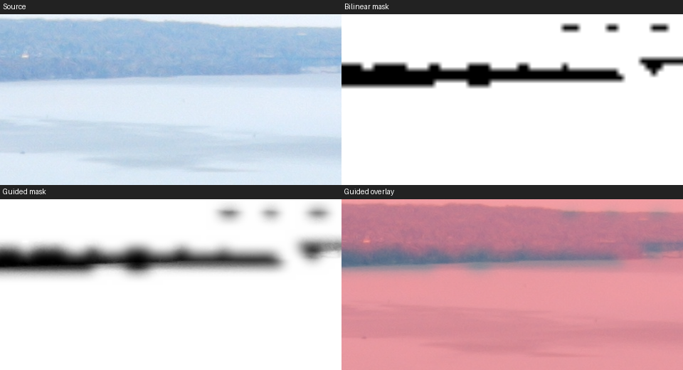

Click-assisted local masking is feasible; automatic selection is not qualified yet. [estimated; M1]
Recommend an optional EfficientSAM-Ti click/box prototype with saved raster masks. [estimated; M1]
CPU inference took 1.12–1.53 seconds here, excluding the rest of the user wait. [measured; M1]
Full-resolution refinement needs tiles: the naïve experiment alone peaked at 3.76 GB. [measured; M1]
AI selection remains outside v1; this investigation changes no product decision. [read; R1]

# B3: offline AI masking — 2026-11-13

Investigation only, branch `research/b3-ai-masking`. **Read** means source evidence, **measured** means this investigation, **estimated** means a proposal/planning allowance. All web links accessed **2026-11-13**. Unknown means not established, not zero. No release-readiness claim.

## Evidence table

Each factual cell cites its source. E1 defines explicitly estimated values. Only EfficientSAM-Ti was run locally. Code and weight grants are considered separately: a permissive repository licence does not automatically clear externally linked weights.

| Option / purpose | Code; weights licence | Download / installed size | Memory, speed and runtime | Maturity / assessment |
|---|---|---|---|---|
| **read:** SAM 2/2.1 click/box [S1] | **read:** Apache-2.0 explicitly covers code and checkpoints [S1] | **read:** tiny 156 MB per weight format [S2]. **estimated:** ONNX deployment 0.2–0.4 GB [E1] | **estimated:** tiny RAM 0.7–2 GB, VRAM 0.5–2 GB; CPU seconds; Apple acceleration subsecond to seconds, unmeasured [E1]. **read:** upstream PyTorch [S1] | **read:** established upstream/2.1 update [S1]. **estimated:** quality challenger; conversion/provider qualification needed [E1] |
| **read:** EfficientSAM-Ti/S click/box [S3] | **read:** Apache-2.0 repository including bundled Ti weights; no separate restriction found [S3] | **measured:** Ti ONNX 41.37 MB, scratch runtime 48.75 MB, combined 90.12 MB excluding existing image dependencies [M1]. **read:** S checkpoint >100 MB [S4] | **measured:** CPU 1.12–1.53 s [M1]. **estimated:** inference RAM 0.4–1.2 GB / VRAM 0.3–1 GB; Apple CoreML 0.1–1 s or CPU 1–5 s, unverified [E1] | **read:** official split ONNX graphs, annotation integrations, successor EfficientTAM linked [S3]. **estimated:** first prototype, not proven best quality [M1] |
| **read:** MobileSAM/v2 [S5] | **read:** Apache-2.0 code and bundled weight; no separate restriction found [S5] | **measured metadata:** GitHub tree 40,728,226-byte `mobile_sam.pt`. **estimated:** deployment 0.1–0.2 GB [E1] | **read:** upstream ~3 s Mac i5 CPU, not Apple silicon [S5]. **estimated:** small-model memory band as EfficientSAM; Steve/Apple speed unknown [E1] | **read:** CPU demo, ONNX support, v2 prompt sampling [S5]. **estimated:** alternative, no demonstrated advantage here [E1] |
| **read:** EdgeSAM [S6] | **read:** S-Lab 1.0 **non-commercial** code; no separately permissive weight grant established [S7] | **estimated:** 9.6 M parameters imply ~38 MB float32 weights; deployment ~0.1–0.2 GB [S6,E1] | **read:** official ONNX/CoreML, upstream 38.7 FPS iPhone 14 [S6]. **estimated:** small-model memory band; desktop/Apple latency unknown [E1] | **read:** training release July 2024 [S6]. **estimated:** reject unrestricted bundling on licence grounds [S7] |
| **read:** SAM-HQ/HQ-SAM2 [S8] | **read:** Apache-2.0 code; exact externally downloaded weight grant not independently cleared [S8] | **estimated:** backbone-dependent hundreds of MB to several GB; installed size unmeasured [E1] | **read:** HQ2 PyTorch/CUDA extension, Windows WSL recommendation [S9]. **estimated:** 1–4+ GB inference RAM/VRAM; CPU seconds to tens, Apple conversion unqualified [E1] | **read:** HQ2 beta, Transformers support June 2025 [S8]. **estimated:** boundary comparator, not alpha-matting guarantee [E1] |
| **read:** SAM 3/3.1 concepts/text [S10] | **read:** custom **SAM License** covers code and weights; restrictions/redistribution clauses, not Apache or simply research-only [S11] | **read:** SAM3 3.44 GB safetensors or 3.45 GB PT; gated; 3.1 exact bytes unknown [S12] | **estimated:** default weights alone consume most of 4 GB app budget before activations; quantized fit unqualified; CPU/Apple/Steve speed unknown [E1] | **read:** 3.1 now advertised, requiring current code [S10]. **estimated:** unsuitable first dependency [E1] |
| **read:** EfficientTAM newer family [S13] | **read:** Apache-2.0 code/model card weights [S13] | **estimated:** checkpoint-dependent; exact download/install unverified [E1] | **read:** upstream >10 FPS iPhone 15 video [S13]. **estimated:** no transferable Mac latency, desktop memory or CPU result [E1] | **read:** EfficientSAM successor link [S3]. **estimated:** monitor; video machinery adds little to single-photo use [E1] |
| **read:** BiRefNet subject/foreground [S14] | **read:** MIT code and official weight card MIT [S14] | **read:** default safetensors 444 MB [S15]. **estimated:** ONNX install ~0.5–0.8 GB [E1] | **estimated:** 1–3+ GB RAM/VRAM, CPU seconds to tens, Apple seconds depending graph coverage; Steve unknown [E1] | **read:** high-resolution dichotomous segmentation, recent compatibility repair [S14,S15]. **estimated:** next automatic-subject candidate, not semantic sky/all people [E1] |
| **read:** U²-Net/U²-NetP saliency [S16] | **read:** Apache-2.0 code; externally linked weight grant not separately verified [S16] | **read:** 176.3/4.7 MB models [S16]. **estimated:** deployed ~0.23/~0.06 GB [E1] | **estimated:** reduced-input RAM/VRAM 0.2–1 GB; CPU 0.2–3 s, Apple 0.1–2 s; Steve unknown [E1] | **read:** 2020 model, later app examples [S16]. **estimated:** cheap baseline, saliency may choose wrong subject [E1] |
| **read:** InSPyReNet saliency [S17] | **read:** MIT code; separate linked-weight grant unresolved [S17] | **estimated:** hundreds of MB by backbone, exact download/install unknown [E1] | **read:** high-resolution pyramid design [S17]. **estimated:** potentially GB-scale RAM/VRAM, CPU seconds to tens; Apple/Steve unknown; ONNX unqualified [E1] | **read:** ACCV 2022 implementation [S17]. **estimated:** refinement comparator [E1] |
| **read:** sky U²-NetP/EGE demo [S18] | **read:** MIT code; separate linked-weight grant unresolved [S18] | **read:** small public model ~2 MB, advertised ONNX 167 MB; high-precision product model withheld [S18]. **estimated:** installed size unknown [E1] | **read:** ncnn/OpenCV/ONNX examples [S18]. **estimated:** small-model memory band; Steve/Apple/CPU latency unknown [E1] | **read:** tree-edge postprocess, building/cloud defects, 2023 update [S18]. **estimated:** example, not qualified sky button [E1] |
| **read:** SCHP human parsing [S19] | **read:** MIT code; exact weight/dataset terms not cleared [S19] | **estimated:** hundreds of MB, exact download/install unknown [E1] | **read:** LIP/ATR/Pascal parts, Python 3.6-era stack [S19]. **estimated:** 1–3 GB memory, CPU seconds to tens; Apple conversion/Steve timing unknown [E1] | **estimated:** relevant to body parts, not inherently fine alpha or per-person instances [S19,E1] |
| **read:** Robust Video Matting people alpha [S20] | **read:** GPL-3.0 code; checkpoint-specific grant needs confirmation [S20] | **estimated:** mobile backbone tens of MB, exact install unknown [E1] | **read:** ONNX/CoreML examples [S20]. **estimated:** reduced-input memory hundreds of MB; native-size budget and desktop timings unknown [E1] | **estimated:** portrait-refinement comparator; copyleft review needed [S20,E1] |
| **read:** Grounding DINO text→boxes [S21] | **read:** Apache-2.0 code; separate checkpoint grant not independently established [S21] | **estimated:** Swin-T ~0.7 GB weights; full package/tokenizer unverified [E1] | **estimated:** RAM/VRAM 1–3+ GB plus segmenter, CPU seconds to tens; Apple conversion/Steve unknown [E1] | **read:** ECCV 2024 upstream [S21]. **estimated:** sequence detector then segmenter, defer text selection [E1] |
| **read:** OWLv2 base text→boxes [S22] | **read:** official weights Apache-2.0; implementation licence must accompany chosen code [S22] | **read:** 620 MB per format plus tokenizer; repository includes duplicate formats [S22]. **estimated:** deployed ~0.7–1 GB [E1] | **estimated:** 1–3+ GB RAM/VRAM, CPU seconds to tens; Apple/Steve unknown, ONNX coverage unqualified [E1] | **estimated:** clearer weight licence, still needs segmentation [S22,E1] |
| **read:** YOLO-World/v2.1 [S23] | **read:** original GPL-3.0; weight grant not cleared. Ultralytics implementation **AGPL-3.0**, distinct distribution [S23,S24] | **estimated:** tens–hundreds MB plus text encoder unless vocabulary precomputed; exact install unknown [E1] | **read:** ONNX examples/reparameterization [S23]. **estimated:** small detector potentially fast, no desktop/Apple/CPU measurement; segmenter adds cost [E1] | **read:** v2.1 February 2025 [S23]. **estimated:** unnecessary complexity for click-first prototype [E1] |

**Estimated — E1:** These are planning ranges for reduced-input, single-model experiments, not measured peaks or shipping promises. Memory allows rough runtime/activation headroom but excludes full-size images, refinement and existing editor occupancy. Speed bands describe orders of magnitude for modern hardware; Apple generation/provider partitioning can invalidate them. Deployment estimates use model bytes plus roughly 50 MB measured CPU runtime as a starting point; native packaged builds, dependencies and converted graphs remain unmeasured. Unknown installation sizes are deliberately not invented.

## Recommendation and integration

**Estimated:** Prototype one optional EfficientSAM-Ti click/box route, CPU first, and compare SAM2.1 tiny before choosing final quality. Official ONNX artifacts and an actual CPU result make Ti a cheap feasibility test. “Not yet” for shipping automatic Sky, Subject, People or named Object selection: this run establishes none of their quality, app-memory or packaging gates. Clicking sky/person/object expresses user intent without establishing automatic semantics; all-people and body-part selection are separate problems.

**Read — R1:** `docs/product/PRD.md:58` requires a substantial whole-wait benefit before new GPU routes; `:129` requires non-destructive sidecars; `:132` protects against silent loss; `:166` excludes AI selection. Architecture and CPU/GPU split: `docs/technical/code-map.md:16`. This investigation changes no v1 scope.

**Estimated — input:** Freeze an orientation-correct, uncropped developed-source proxy before local/creative grades. Convert scene-linear HDR through a versioned deterministic SDR rendering into sRGB RGB [0,1], using a luminance-preserving highlight shoulder, explicit gamut mapping and fixed developed-source exposure/white balance. Do not feed clipped linear HDR or screenshots. Record source/development fingerprint, proxy hash, resize/padding and recipe version. Compare this candidate with the existing SDR base on backlit/hazy scenes before choosing the exact curve. No HDR-input trial was performed.

**Read:** Edge/Feather/Edge detail already has source-pixel controls and guided-filter epsilon rules (`docs/technical/local-adjustments.md:3`); hue refinement also has chroma-specific gates (`:42`). **Estimated:** Reuse controls and bounded machinery, not hue qualification. Coarse proposal → full-size refinement → Edge grow/shrink → Feather → final coverage. Bake initial refinement so accepted masks do not depend on later grades.

**Estimated — full-resolution edges:** Guided upsampling can align an approximately correct boundary; it cannot recreate omitted branches or correct subject identity. Use overlapping tiles with halos covering every filter pass. If necessary evaluate trimap matting only in uncertain boundary bands, or contextual high-resolution crop inference. Independent segmenter tiles risk inconsistent subjects/seams. Hair/translucency need alpha-quality evidence, not just binary IoU. The measured failure below rules out claiming guided filtering alone solves sky/tree edges.

**Estimated — storage:** Add immutable `raster_selection` leaves referencing losslessly compressed tiled uint16 coverage assets in source coordinates, with dimensions/orientation, content hash and revision. Sidecars reference assets; project transfer copies/embeds them. Asset pixels are authoritative. Keep clicks/boxes, model hash/licence, proxy hash, preprocessing/refinement versions, provider and precision as provenance. “Recompute” creates a new undoable revision; opening, export and model upgrades never infer again. Write asset before atomic document update; missing assets report damage rather than silently regenerate.

**Estimated arithmetic:** 24–60 MP coverage costs 24–60 MB uint8, 48–120 MB uint16 or 96–240 MB float32 uncompressed per mask. Compression is content-dependent. **Measured:** this 48 MP uint16 PNG was 4,864,263 bytes [M1]. **Estimated:** external assets avoid giant JSON/base64; stream tiles instead of decoding all masks simultaneously.

**Read:** Typed mask leaf/expressions exist (`codebase/backend/hdr_finisher/models.py:717`, `:822`), CPU local processing is tiled and byte-mask caches bounded (`docs/technical/local-adjustments.md:645`). **Estimated:** Extend the union and both renderers, using existing Boolean/invert/opacity semantics with brush/path/luma/hue. Specify identical source-coordinate sampling and coverage-preserving downsampling. Export reads committed raster bytes, not fresh inference. GPU/CPU inference drift then cannot silently change saved projects; renderer parity still matters. Final refinement revision must be committed before export.

**Read:** Whole-app RAM ceiling is min(4 GB, quarter physical RAM), floor 2.5 GB, including helpers (`docs/product/modules/memory-and-caches.md:697`); default acceptance includes ≤4.4 GB peak and <3.4 GB settled (`:77`). VRAM has shared broker accounting, distinguishing a 2 GiB policy default from automatic half-dedicated-memory reporting (`:758`). **Estimated:** use live grants/occupancy, never assume Steve's 12 GB card supplies an AI allowance. Apple unified memory must stay inside app accounting. No tested model has demonstrated concurrent app-budget compliance.

**Estimated — runtime/package:** Use a cancellable Python helper and pinned audited ONNX graphs, with measured RAM/VRAM reservations, foreground preemption and prompt embedding eviction. Bundle native ORT libraries via PyInstaller; Electron handles requests/progress, not model execution. Linux Flatpak CPU is the initial fallback; Linux GPU needs separate provider/driver qualification. Windows DirectML/macOS CoreML are optional, not assumed to accelerate every operator. Ship models offline or explicitly import them; no inference-time downloads. Test packaged cold start, native-library discovery, cancellation and read-only install directories. No packaging build was run.

**Read:** ORT provides CPU/platform providers [S25]; DirectML has session restrictions and sustained-engineering status [S26]; CoreML has operator/options limitations [S27]. **Estimated:** freeze per-platform builds, inspect graph partition coverage, attempt GPU once then CPU according to project policy. Only add GPU if whole-wait savings earn philosophy 3.

## Measured results — M1

**Measured:** CIM/`nvidia-smi`: Ryzen 5 7600, RTX 4070 Ti 12,282 MiB. GPU unused. Shared `.venv` had no Torch/ORT. ORT 1.31.1 and psutil installed only under excluded `scratch/runtime`; existing NumPy/Pillow/OpenCV reused. No shared environment modification. Worktree lacked AGENTS.md; read main checkout's AGENTS.md. Git ownership exception supplied per command, no global configuration edit.

**Measured:** Official Ti ONNX SHA-256 `143c3198a7b2a15f23c21cdb723432fb3fbcdbabbdad3483cf3babd8b95c1397`, 41,365,520 bytes. Read-only main-checkout test copy `codebase/output/test-photos/hdr-test/DJI Samples/DJI_0071.JPG`, 8000×6000, resized to 1024×768 RGB /255. Positive point (512,45), negative (512,350); highest predicted-IoU candidate (0.8196), logits threshold zero. Predicted score is not measured ground-truth IoU.

**Measured:** CPU provider, six intra-op threads. Trial one: session 0.549 s, model calls 1.289/1.172/1.118 s. Crop-corrected repeat: session 0.874 s, calls 1.166/1.533/1.370 s. Warm file cache, not app cold start. Within each three-call set, max output difference zero. GPU/CPU/cross-platform determinism untested. Monolithic ONNX reruns encoder; split decoder click latency unmeasured.

**Measured:** Bilinear upsample; scalar full-size grayscale guided filter radius 8, epsilon .003, float32 reflect borders. Refinement 1.726/1.967 s. Repeat peak working set 3,757,490,176 bytes, ending RSS 3,183,095,808. Includes retained experiment arrays/copies, not isolated inference. Repeat session+model+refinement subtotal 4.01–4.37 s excludes decoding/write/IPC/draw; not complete user wait. Naïve full-frame refinement is unsuitable alongside the editor.

**Measured visual observation:** Native crop is a failure example: proposal includes water and landscape; refinement softens blocks without correcting semantics. It contains sky/wooded horizon, not close foliage or hair. Crop x=3760..4240, y=1680..1920; panels 480×240 source pixels.

**Measured reproducibility recipe:** Feed NCHW RGB float32 [0,1], coordinates shape [1,1,2,2], labels [1,0] float32. For grayscale I and enlarged binary P, box=17×17 reflect: a=(box(IP)−box(I)box(P))/(box(II)−box(I)²+.003), b=box(P)−a box(I), q=clip(box(a)I+box(b),0,1). Time with `perf_counter`; peak via psutil Windows `peak_wset`. Scratch model/runtime/scripts/full mask deleted; only report/crop retained.

## First step, risks, tolerances and questions

**Estimated:** First spike: split Ti encoder/decoder, tiled refinement, immutable raster storage. Compare SAM2.1 tiny on labelled sky/tree holes, hair, low contrast, crowds, transparent/reflective objects and HDR highlights. Measure first click to final displayed mask, further clicks, cold load and whole-app memory. Do not begin with five automatic buttons.

**Estimated proposed measurement gates; not existing accepted tolerances:**

- Stored-mask reload/export hash exact: saved selections must never change.
- Same-provider threshold disagreement ≤0.01% investigation trigger: tiny logit drift can flip edges; also record logit differences.
- CPU/GPU/CoreML IoU ≥0.995, soft-coverage MAE ≤1/255, boundary F-score ≥0.98 within two source pixels: separately inspect boundary bands because large interiors hide defects.
- Tiled/full refinement mean ≤1/65535 and p99.9 ≤2/65535 coverage error: quantify quantization-scale drift and inspect joins.
- Native quality: human-labelled boundary/false-hole evaluation plus Steve's ±2 EV edit review: IoU alone cannot qualify halos.
- Warm first final selection target ≤3 s, subsequent proposal ≤200 ms: measure interaction, not throughput; pending refinement must be visible.
- Existing whole-app/VRAM limits unchanged, no unaccounted helper memory: standalone success does not establish app fit.
- Existing delivered-image parity/peak checks unchanged: mask agreement cannot replace export qualification. **Read:** mean <1/p99.9 ≤3 limits and existing exceptions are documented in `docs/product/modules/export-and-proof.md:73–81`.

**Estimated risks:** Ambiguous intent, lost small features and HDR proxy appearance dominate quality. Providers/precision/candidate ranking can change a new proposal; fixed seeds do not ensure parity. Authoritative stored bytes prevent this changing saved masks. Model licences and exact weight grants require closure; copyleft is not automatically incompatible with a free app, but obligations need review. Storage multiplies with masks. No automatic category, Apple hardware, CPU/GPU parity or packaged runtime is qualified here.

**Estimated open questions:** Click assistance or truly automatic buttons first? Which Apple generation/8 GB machine must pass? uint16 versus uint8 storage? Which frozen HDR proxy curve works best? Does split CPU decoding meet latency? Does boundary matting improve hair/foliage enough within budget? Resolve table weight-grant uncertainties before advancing those options.

## Sources

All accessed 2026-11-13. Primary upstream sources; local citations above identify repository files/lines.

[S1]: https://github.com/facebookresearch/sam2
[S2]: https://huggingface.co/facebook/sam2.1-hiera-tiny/tree/main
[S3]: https://github.com/yformer/EfficientSAM
[S4]: https://github.com/yformer/EfficientSAM/blob/main/EfficientSAM_example.py
[S5]: https://github.com/ChaoningZhang/MobileSAM
[S6]: https://github.com/chongzhou96/EdgeSAM
[S7]: https://github.com/chongzhou96/EdgeSAM/blob/master/LICENSE
[S8]: https://github.com/SysCV/sam-hq
[S9]: https://github.com/SysCV/sam-hq/blob/main/sam-hq2/README.md
[S10]: https://github.com/facebookresearch/sam3
[S11]: https://github.com/facebookresearch/sam3/blob/main/LICENSE
[S12]: https://huggingface.co/facebook/sam3/tree/main
[S13]: https://huggingface.co/yunyangx/efficient-track-anything
[S14]: https://huggingface.co/ZhengPeng7/BiRefNet
[S15]: https://huggingface.co/ZhengPeng7/BiRefNet/tree/main
[S16]: https://github.com/xuebinqin/U-2-Net
[S17]: https://github.com/plemeri/InSPyReNet
[S18]: https://github.com/xiongzhu666/Sky-Segmentation-and-Post-processing
[S19]: https://github.com/GoGoDuck912/Self-Correction-Human-Parsing
[S20]: https://github.com/PeterL1n/RobustVideoMatting
[S21]: https://github.com/IDEA-Research/GroundingDINO
[S22]: https://huggingface.co/google/owlv2-base-patch16-ensemble/tree/main
[S23]: https://github.com/AILab-CVC/YOLO-World
[S24]: https://github.com/ultralytics/ultralytics/blob/main/LICENSE
[S25]: https://onnxruntime.ai/docs/execution-providers/
[S26]: https://onnxruntime.ai/docs/execution-providers/DirectML-ExecutionProvider.html
[S27]: https://onnxruntime.ai/docs/execution-providers/CoreML-ExecutionProvider.html

Graphics minutes used: **0**. Output size before/after: **0.0/0.0 GB** in worktree via `tools/output_size.py`; shared main-checkout output measured separately **45.9 GB**, read-only. Scratch deleted; report and one small PNG retained.

